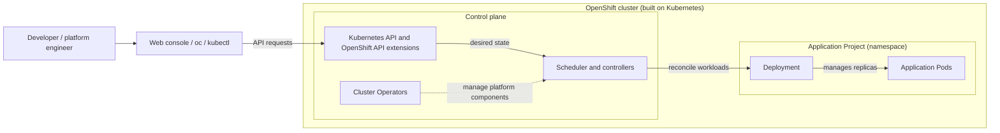
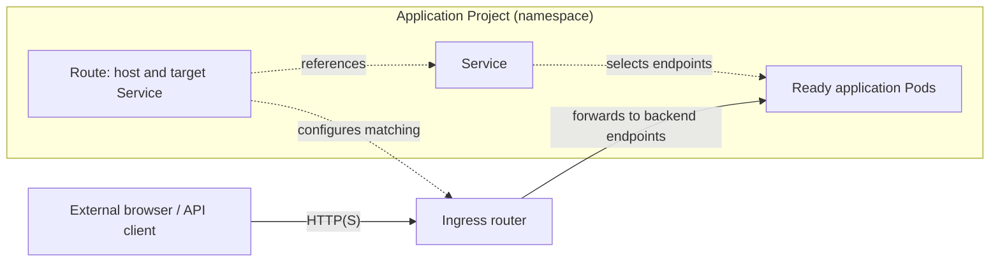

# OS-01-01 — What Is Red Hat® OpenShift® Container Platform, and How Is It Different from Kubernetes?

> **Audience:** Students, software developers, and first-time platform engineers  
> **Track:** T0 — Foundations · **Module:** 01 · **Estimated reading + activities:** 25–35 minutes  
> **Prior knowledge:** Containers, a basic idea of a Kubernetes Pod, and a willingness to read diagrams. The recommended prerequisite is OS-00-02, which is not yet published.  
> **Reference release:** Red Hat® OpenShift® Container Platform (OCP) **4.22** documentation, reviewed 2026-11-09. The general mental model also applies more broadly, but detailed defaults can differ by release and product.  
> **Environment:** C — conceptual/offline. **Required cluster privileges:** none. **Cost:** none for this lesson.  
> **Verification:** Technical claims cross-checked against official Red Hat and Kubernetes documentation; no cluster, command, or deployment has been tested.  

## 1. The question this lesson answers

Suppose a team has developed a web application. Locally it runs in a container. In production, however, the team needs several replicas, recovery after failures, networking, access control, and a repeatable way to deploy updates.

**Kubernetes** supplies the orchestration foundation: a declarative API and controllers that keep containerized workloads close to their desired state.

**Red Hat® OpenShift® Container Platform** is a Kubernetes-based application platform that provides a more integrated experience for deploying and operating those workloads. It retains Kubernetes concepts while adding its own APIs, tooling, platform services, security mechanisms and lifecycle management. [R1], [R2]

The essential distinction is **not** "Kubernetes runs containers, while OpenShift runs applications." Kubernetes already runs applications. OpenShift builds an opinionated, integrated platform *on top of* the Kubernetes foundation.

### Learning objectives

By the end, you should be able to:

1. Explain what Kubernetes already does and why a platform built on it can be useful.
2. Identify standard Kubernetes resources versus OpenShift-specific concepts.
3. Read a simplified OpenShift architecture diagram and trace a browser request to application workloads.
4. Explain the basic roles of the OpenShift web console, `oc`, projects, Routes, and Operators.
5. Recognize when a lab requires no cluster, project-level access, or administrative permission.

## 2. A useful mental model

Think about three layers:

- **Your application:** Source code, a container image, and the workload you want to run.
- **Kubernetes orchestration:** API server, scheduling, Deployments, Pods, Services, storage and reconciliation controllers.
- **OpenShift platform integration:** The Kubernetes foundation plus OpenShift-specific APIs and services such as Projects, Routes, the `oc` experience, cluster platform Operators, curated operational integrations, and OpenShift security controls.

This is a **teaching model, not a literal software layering diagram**. OpenShift is a Kubernetes distribution/platform: some components extend Kubernetes APIs, others configure or operate Kubernetes components, and some are optional add-ons. You do not install two independent clusters called "Kubernetes" and "OpenShift." [R1], [R3]

### Comparison: what belongs where?

| Question | Kubernetes foundation | OpenShift Container Platform 4.22 context |
| --- | --- | --- |
| What schedules and runs application Pods? | Kubernetes scheduling, nodes, kubelet, and controllers. | Same Kubernetes foundation, deployed and operated as part of the OpenShift cluster. |
| What represents a replicated stateless workload? | A `Deployment` managing replicated Pods. | The same Kubernetes `Deployment` resource is supported; OpenShift also exposes additional platform APIs. |
| How are internal application endpoints discovered? | Kubernetes `Service` and cluster DNS. | Kubernetes `Service` is still used. |
| How can a browser reach an HTTP application from outside? | Kubernetes `Ingress` (with an installed controller), Gateway API in supported setups, or other configured networking options. | OpenShift offers its `Route` API and also supports Kubernetes `Ingress` through its ingress infrastructure. |
| How is a team's application boundary represented? | A Kubernetes `Namespace`. | An OpenShift `Project` is a Kubernetes namespace with additional annotations and project-oriented management conventions. |
| How are operations automated? | Kubernetes controllers and Operators can be developed or installed. | OpenShift uses default **Cluster Operators** for platform functions and may use separately installed **add-on Operators**. Operators are **not exclusive** to OpenShift. |
| How do you interact with the API? | `kubectl` and Kubernetes-compatible clients. | `oc` extends the Kubernetes CLI experience with OpenShift-aware commands, and `kubectl` remains supported. A web console provides a graphical interface. |
| Who can do what, and what is allowed in a Pod? | Kubernetes RBAC, admission controls, Pod Security Admission and other policy components. | Kubernetes mechanisms remain; OpenShift additionally uses Security Context Constraints (SCCs). Security features do not eliminate the need for secure configuration. |
| What builds container images? | Kubernetes itself does not prescribe a full source-to-image build platform. | OpenShift has `BuildConfig` and `ImageStream` APIs and supports other toolchains; actual availability and recommended workflows depend on the environment/version. |
| Does every cluster come with every add-on? | No. | No. Some core platform Operators are installed by default; application-specific Pipelines, GitOps and other add-ons may need separate installation and appropriate privileges. |

**Check the nuance:** A `Route` is OpenShift-specific, but HTTP ingress is not uniquely an OpenShift capability. Operators exist across Kubernetes distributions. A Project maps to a namespace, but the project-oriented management and permission experience adds OpenShift conventions. [R2], [R3], [R4], [R5], [R6], [R7], [R8]

## 3. Architecture: where the platform and your app meet

The two original diagrams below separate **declarative API operations** from **application traffic**. They are simplified logical models, not complete infrastructure or packet-path diagrams.

### A. Desired state and workload management

**Accessible description:** A developer uses the web console or command-line tools to send API requests to the cluster control plane. The API stores desired configuration; controllers and the scheduler help reconcile and place application workloads. Inside an application Project, a Deployment manages replicated application Pods. Cluster Operators manage platform components.

### B. External request traffic

**Accessible description:** A browser sends HTTP(S) traffic to the ingress router. The Route records a hostname-to-Service mapping and informs the router's configuration; the Service selects healthy, ready application endpoints. The router can deliver traffic to corresponding backend Pod endpoints. Dotted lines express resource references or configuration relationships; solid lines express the logical request path.

**Traffic-path caveat:** The Route is an API configuration object, **not the router process**. The diagrams show logical relationships, not a guaranteed network path through a Service virtual IP or kube-proxy. The OpenShift router may send traffic directly to backend endpoints. The actual dataplane depends on ingress configuration. [R4]

### Trace two different flows

**Control flow (desired state):**

1. A developer or operator uses a console or `oc` client to submit resource declarations to the API.
2. Kubernetes controllers continuously compare the declared state with actual resources.
3. Worker-node components run the application Pods; controllers reconcile failures or changes.
4. OpenShift's platform Operators watch and manage relevant cluster services and lifecycle responsibilities.

**Request flow (user traffic):**

1. An external client sends an HTTP(S) request for the application's configured hostname.
2. The configured ingress infrastructure receives the request.
3. A `Route` (or, alternatively, a supported `Ingress`) defines how that hostname targets a service.
4. Traffic reaches an appropriate application endpoint backed by a Pod.

The two flows solve **different problems**: declaring and maintaining workloads versus delivering client traffic to workloads. [R1], [R4], [R6]

## 4. Five OpenShift concepts to recognize early

### 4.1 Project: your team's working space

A Kubernetes namespace groups namespaced resources and enables scoped access, policy and quota management. OpenShift presents a Project as a namespace with extra annotations and project-oriented user workflows. Not all Kubernetes resources are namespaced: for example, nodes are cluster-scoped. A Project is **not automatically a separate physical cluster**. [R3]

**Scenario:** A team can have a `training-app` Project for sample workloads while another team has its own Project. Whether each team can read or change resources depends on RBAC and policy—not just the existence of different names.

### 4.2 Route: a hostname for an HTTP(S) application

A Kubernetes Service gives applications a stable discovery/targeting abstraction inside the cluster. An OpenShift Route associates an external hostname with a Service for HTTP(S) routing through OpenShift ingress. Kubernetes Ingress is also supported, so the difference is not "Kubernetes cannot expose websites." [R4]

**Scenario:** A user visits an application hostname. The configured ingress infrastructure handles the request and routes it to selected application backends. Certificate termination and routing behavior depend on configuration.

### 4.3 oc: the OpenShift-aware command-line client

The OpenShift CLI `oc` supports familiar `kubectl` functions and offers additional commands for OpenShift features—for example, project selection, login workflows, application creation helpers, and OpenShift-specific objects. Existing `kubectl` workflows against standard Kubernetes APIs remain relevant. [R5]

**Conceptual examples (not executed in this lesson):**

| Question | Command family you might explore in a future lab |
| --- | --- |
| Which Project am I using? | `oc project` |
| What Pods can I see? | `oc get pods` |
| Which Routes exist in my Project? | `oc get routes` |
| What did the API record about a workload? | `oc describe deployment APP_NAME` |

These are illustrative command names, **not an executable walkthrough**. The next practical lessons will specify login, scope, permissions, expected outputs and cleanup. Never share or commit a live kubeconfig or CLI tokens.

### 4.4 Operators: software that operates software

An Operator runs reconciliation logic to automate lifecycle tasks for a component or application. A cluster controller or Operator observes current state and acts to approach the declared desired state. OpenShift uses **Cluster Operators** managed as part of platform lifecycle and **optional add-on Operators** that can be installed and managed separately; not every Operator is present on every cluster. Operators can also run on upstream Kubernetes. [R6]

**Scenario:** An Operator may configure or recover a managed service based on custom resources. The actions it can perform depend on the Operator's implementation and its permissions.

### 4.5 Security controls: policy at multiple layers

RBAC controls whether an identity is allowed to perform an action. Pod-level admission controls determine which workload configurations may be admitted. OpenShift uses Security Context Constraints (SCCs) alongside Kubernetes Pod Security Admission (PSA); these are different mechanisms, not synonyms. Restrictions may differ across distributions, versions, and managed installations. [R7]

**Scenario:** A container that expects to run as root or mount host paths may be rejected by policy. The right response is to understand the requirement and adjust the container/design or use an authorized policy—**not** to disable controls globally for a tutorial.

## 5. A beginner scenario: publish a tiny web service

Imagine a simple web application serving a page that says "Hello from a cluster." You need:

1. A **container image** holding the application.
2. A **Deployment** telling Kubernetes how many Pods should run.
3. **Pods** that actually execute the application.
4. A **Service** that groups the app's endpoints under a stable logical name.
5. An optional **Route** (or configured Ingress) for external HTTP(S) access.
6. Proper permissions, networking policies and resources for the actual environment.

The example is **illustrative, not a deployed system**. This introductory lesson has no runnable YAML manifest: an honest, version-specific lab requires selecting a safe image, checking quotas and SCC compatibility, running the commands on a disposable cluster, verifying behavior, and testing cleanup.

### What changes if a Pod fails?

Kubernetes provides controllers that can replace failed Pods to restore a Deployment's desired replica count. OpenShift does not invent that reconciliation loop; it operates and augments the Kubernetes platform around it. Application-level correctness still requires good probes, error handling, resource sizing, and suitable storage choices. [R1], [R2]

### What if a new learner cannot create a Route?

That does not prove Kubernetes or OpenShift routing is broken. The learner might lack create permissions, quota, the appropriate Project, or a suitable ingress configuration. A future lab should have the learner inspect **authorization and cluster configuration**, rather than trying privileged workarounds.

## 6. Common misconceptions

| Misconception | More accurate statement |
| --- | --- |
| "OpenShift replaces Kubernetes." | It is a Kubernetes-based platform/distribution that extends and integrates Kubernetes. |
| "Kubernetes has no security." | Kubernetes provides native authentication, authorization and admission mechanisms; OpenShift adds its own policies/integrations. |
| "Only OpenShift has Operators." | Operators are a broader Kubernetes pattern; OpenShift incorporates and manages them in defined ways. |
| "A Route is the same thing as a Pod." | A Route defines ingress configuration, while a Pod runs application containers. |
| "A Project is a separate cluster." | A Project is an OpenShift namespace-based boundary within a cluster. |
| "A Service always sends network packets through one mandatory virtual hop." | A Service is a logical abstraction; actual dataplane and ingress routing paths vary. |
| "The console is the whole product." | The console is one interface to the APIs and services of a much larger platform. |
| "Every Kubernetes YAML works identically everywhere." | API compatibility matters, but admission policies, image constraints, permissions and installed extensions affect real behavior. |

## 7. No-cluster exercise (do this now)

**Time:** about 5–8 minutes. **Requirements:** just this page. **No deployments are created.**

### Exercise A — Label each element

For each item, label it **K** (standard Kubernetes resource/concept), **O** (OpenShift-specific concept/API), or **B** (broader Kubernetes technique adopted by OpenShift).

| Item | Your answer |
| --- | --- |
| Deployment | ____ |
| Pod | ____ |
| Service | ____ |
| Project | ____ |
| Route | ____ |
| Operator pattern | ____ |
| oc CLI | ____ |
| Namespace | ____ |
| Security Context Constraint | ____ |

### Exercise B — Explain the two flows

Consider a browser visiting a site whose application runs in Pods. Write one sentence for each:

1. What object represents the desired number of application Pods?
2. Why do you need a Service in a typical multi-Pod application?
3. What role does a Route play, and is the Route itself a proxy process?
4. What remains true if the application is moved from one working Pod to another?

### Exercise C — Choose the right learning environment

A learner can deploy workloads inside an assigned Project but cannot edit cluster networking components. Is it appropriate to teach them to create an application Deployment? Is it appropriate to require them to change the cluster Ingress Controller configuration? Explain which exercise might require additional permissions.

## 8. Answers and explanations

**Exercise A:** Deployment = K; Pod = K; Service = K; Project = O; Route = O; Operator pattern = B; `oc` = O; Namespace = K; SCC = O. The Operator pattern is usable on many Kubernetes distributions even though OpenShift has its own platform and add-on Operator systems.

**Exercise B:**

1. A Deployment declares the application Pod template and desired replica count.
2. A Service provides a stable logical target and selects suitable endpoints while Pods can be replaced.
3. A Route stores an OpenShift-specific host-to-service routing configuration. The ingress router/controller handles the traffic.
4. The Service's logical address remains a stable abstraction while matching backend Pod endpoints change; user traffic can continue subject to application health and routing readiness.

**Exercise C:** A Project-scoped Deployment is a reasonable developer exercise **if** the user has the required RBAC and quota. Changing a cluster-level Ingress Controller generally needs administrative privileges and should be reserved for a dedicated admin lab—not taught as a routine developer Sandbox step.

## 9. Summary

- Kubernetes supplies the declarative APIs, scheduling, workload abstractions and reconciliation mechanisms.
- OpenShift is built on Kubernetes and provides an integrated platform with additional APIs, tooling, services, lifecycle management and policy.
- A Project, Route and `oc` are useful OpenShift-specific concepts, while Deployments, Pods, Services and Operators have wider Kubernetes foundations.
- Separate **desired-state control flow** from **application request traffic**.
- Learn concepts before attempting administrative commands; privilege and environment compatibility matter.

### Where to go next

The next planned lesson is **OS-01-02 — Projects, Routes, Operators, the web console and oc**. A later practical lab, **OS-03-01**, will demonstrate logging in and inspecting an authorized Project after its environment and commands are actually tested. Those follow-on resources will be linked when they have been completed, verified, and released.

## 10. References and verification record

The explanation was written as an original educational synthesis, not a reproduction of vendor text. The following authoritative documentation was reviewed on **2026-11-09**:

| ID | Reference | Supports | Release |
| --- | --- | --- | --- |
| R1 | [Red Hat OpenShift architecture](https://docs.redhat.com/en/documentation/openshift_container_platform/4.22/html/architecture/index) | Platform components, Kubernetes base, control plane | OCP 4.22 |
| R2 | [Kubernetes overview](https://kubernetes.io/docs/concepts/overview/) | What Kubernetes provides, and its non-monolithic design | Upstream rolling docs |
| R3 | [OpenShift projects and RBAC](https://docs.redhat.com/en/documentation/openshift_container_platform/4.22/html/authentication_and_authorization/using-rbac) | Namespace/Project model and access boundaries | OCP 4.22 |
| R4 | [OpenShift Ingress Operator](https://docs.redhat.com/en/documentation/openshift_container_platform/4.22/html/networking_operators/configuring-ingress) | Ingress Controller, Routes and Ingress resources | OCP 4.22 |
| R5 | [OpenShift CLI oc](https://docs.redhat.com/en/documentation/openshift_container_platform/4.22/html/cli_tools/openshift-cli-oc) | oc and kubectl, OpenShift-specific commands | OCP 4.22 |
| R6 | [OpenShift Operators overview](https://docs.redhat.com/en/documentation/openshift_container_platform/4.22/html/operators/operators-overview) | Platform versus optional Operators | OCP 4.22 |
| R7 | [Pod Security Admission in OpenShift](https://docs.redhat.com/en/documentation/openshift_container_platform/4.22/html/authentication_and_authorization/understanding-and-managing-pod-security-admission) | PSA and SCC as distinct policies | OCP 4.22 |
| R8 | [OpenShift BuildConfig builds](https://docs.redhat.com/en/documentation/openshift_container_platform/4.22/html/builds_using_buildconfig/build-strategies) | BuildConfig and ImageStream concepts | OCP 4.22 |

**Validation status:** Documentation cross-checked; diagram and reasoning exercises drafted. **Not tested:** any `oc` command, YAML apply, application deployment, ingress route, or real cluster environment. The release was not selected as a course-wide lab target. A subsequent editorial review must refresh links, confirm release-specific details, and inspect any final public copy.

**Independence and trademarks:** This independently prepared course has no affiliation with Red Hat, LLC. Red Hat® and OpenShift® are trademarks of Red Hat, LLC, registered in the United States and other countries. These marks are used here for identification only and do not imply affiliation with or approval by Red Hat. No Red Hat logos are used.
